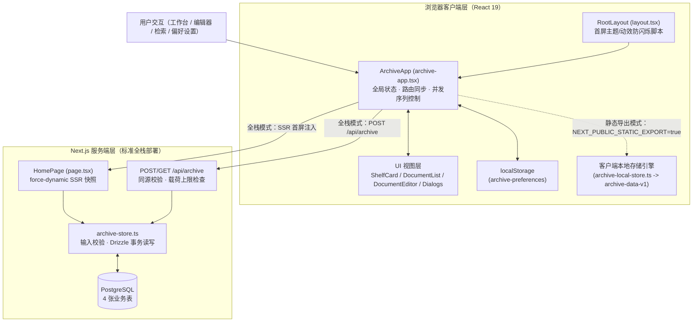
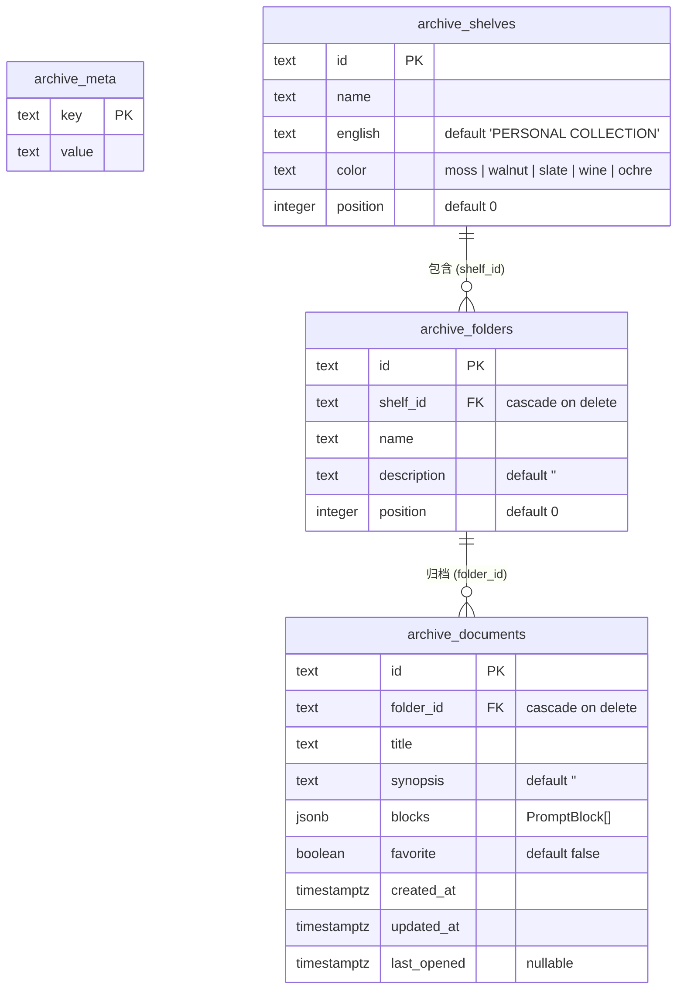
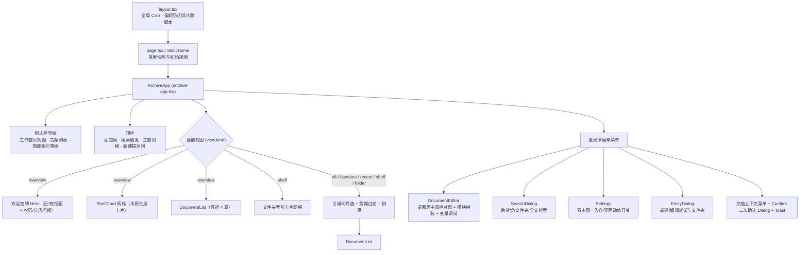

# 词境仓库（Prompt Archive）项目架构说明

> 本文档基于对初始原型代码库（`v0.1.0`）的逐文件审读编写，用于梳理系统分层、数据模型、前后端交互机制、视觉样式体系及双模式部署方案，作为后续功能演进与版本维护的技术基线。

---

## 1. 项目定位与技术栈

**词境仓库（Prompt Archive）** 是一款以纸张、木纹与黄铜索引柜为视觉隐喻的多层级提示词管理与本地调试工作台，核心流程围绕 **货架（Shelf）→ 文件夹（Folder）→ 提示词文档（PromptDoc）→ 结构化模块（PromptBlock）** 展开。

| 类别 | 技术选型 | 版本（来自 `package.json`） | 说明 |
| --- | --- | --- | --- |
| 应用框架 | Next.js（App Router） | `16.4.5` | 支持服务端动态渲染、API Route Handlers 与静态导出双模式 |
| UI 运行时 | React / React DOM | `19.2.6` | 服务端首屏快照注入 + 客户端全量交互工作台 |
| 类型系统 | TypeScript | `5.9.3` | 开启 `strict: true`，前后端共享类型与纯函数工具 |
| 样式方案 | Tailwind CSS v4 + 自定义 CSS 设计系统 | `4.1.17` | `@import 'tailwindcss'` 搭配 `globals / workspace / workbench / responsive / fonts.css` |
| 数据层与 ORM | PostgreSQL + Drizzle ORM + `pg` | `0.45.2` / `8.20.0` | 事务化初始化、外键级联删除、JSONB 模块存储 |
| 端到端测试 | Playwright | `^1.65.1` | `tests/archive.spec.ts` 覆盖真实 CRUD、变量编译、移动端与服务端校验 |
| 代码规范 | ESLint + `eslint-config-next` + Prettier | `9.39.4` / `^3.10.1` | 扁平配置 `eslint.config.mjs` |

---

## 2. 目录结构与模块职责

```text
.
├── public/
│   ├── archive.svg                 # 应用 Favicon（等距木质索引柜矢量图标）
│   ├── fonts/                      # 本地 Noto Serif/Sans SC 字体子集（5 份 .ttf）与 OFL 许可声明
│   └── images/                     # 档案室日/夜景插画（archive-room*.jpg）与轻拟物 SVG 纹理（grain.svg、wood.svg）
├── src/
│   ├── app/
│   │   ├── api/
│   │   │   ├── archive/route.ts    # GET 读取仓库 / POST 执行受校验的仓库变更
│   │   │   └── health/route.ts     # GET 数据库连通性探针（select 1）
│   │   ├── error.tsx               # 根路由错误边界（连接异常恢复页）
│   │   ├── layout.tsx              # 根布局、元数据、首屏防闪烁偏好脚本
│   │   ├── page.tsx                # 首页入口（读取数据库快照并解析 URL 视图）
│   │   ├── fonts.css               # 本地字体 @font-face 与 Unicode-range 声明
│   │   ├── globals.css             # CSS 设计 Token、双主题变量、基础按钮与关键帧动画
│   │   ├── workspace.css           # 侧边栏、欢迎牌、货架抽屉、文件夹卡片与文档列表样式
│   │   ├── workbench.css           # 弹层、设置面板、全局搜索框、居中双栏工作台与变量调试样式
│   │   └── responsive.css          # 桌面宽屏/紧凑屏/平板抽屉/移动端适配与降动效规则
│   ├── components/
│   │   ├── archive-app.tsx         # 工作台主容器与全局状态中心
│   │   ├── archive-select.tsx      # 纸质黄铜风自定义可访问下拉选择器（替代原生 select）
│   │   ├── editor.tsx              # 居中式双栏对照文档工作台（双栏对照 / 模块编辑 / 变量调试 / 完整输入）
│   │   ├── preset-dialog.tsx       # 自定义板块预设库与未匹配 Markdown 标题处理弹窗
│   │   ├── archive-dialogs.tsx     # 实体表单弹窗、仓库设置弹窗、全局搜索弹窗
│   │   ├── dialog.tsx              # 无障碍 Overlay 与 Dialog 基础容器（焦点陷阱/滚动锁定）
│   │   ├── document-list.tsx       # 文档表格视图、纸页微缩图标、相对时间格式化
│   │   ├── shelf-card.tsx          # 轻拟物木质抽屉卡片（铭牌、螺丝、黄铜拉手）
│   │   └── icons.tsx               # 全量自绘 SVG 图标、ArchiveMark 与渐变 BrassPull
│   ├── db/
│   │   ├── index.ts                # pg.Pool 单例连接与 Drizzle 实例导出
│   │   └── schema.ts               # archive_meta / archive_shelves / archive_folders / archive_documents 表定义
│   └── lib/
│       ├── archive-types.ts        # 领域模型、模块标签/模板/自定义预设、拼装与 {{变量}} 引擎
│       ├── archive-markdown.ts     # 完整提示词 Markdown 标题智能解析与模块双向无损同步
│       ├── archive-store.ts        # PostgreSQL 事务初始化、输入校验与 Drizzle CRUD（含 presets）
│       ├── archive-seed.ts         # 初始 3 货架 / 9 文件夹 / 24 篇示例馆藏生成器
│       ├── archive-navigation.ts   # URL query 与 legacy hash 视图双向解析
│       └── archive-dates.ts        # 亚洲/上海时区问候语、公历与农历日期转换
├── tests/
│   └── archive.spec.ts             # Playwright E2E 与接口校验测试套件
├── drizzle.config.json             # Drizzle Kit PostgreSQL 配置
├── next.config.ts                  # Next.js 构建配置
└── tsconfig.json                   # TypeScript 编译配置（@/ 映射至 ./src/）
```

---

## 3. 系统架构与数据流

### 3.1 总体分层与双运行模式

项目在原始全栈架构之上支持 **服务端 PostgreSQL 模式** 与 **静态预览 `localStorage` 模式**（用于 GitHub Pages 等纯静态托管环境）：



### 3.2 数据库 ER 模型（`src/db/schema.ts`）



关键约束与初始化机制：
- **级联删除与索引**：`archive_folders.shelf_id` 与 `archive_documents.folder_id` 均配置 `onDelete: 'cascade'`，并分别建立索引 `archive_folders_shelf_idx` 与 `archive_documents_folder_idx`。删除货架或文件夹时，数据库自动清理下属记录；前端在删除前会统计受影响文档数量并二次确认。
- **单次幂等初始化（`seedOnce`）与自定义板块预设持久化**：`src/lib/archive-store.ts` 在模块内缓存 `initialized` Promise，并在 PostgreSQL 事务中通过 `pg_advisory_xact_lock(71120317)` 加咨询锁检查 `archive_meta.key = 'initialized'`；自定义板块预设（`BlockPreset[]`）以 JSON 形式持久化于 `archive_meta.key = 'block_presets'`（静态模式存于 `localStorage['archive-data-v1'].presets`），无需修改数据库表结构。
- **排序规则（`readArchive`）**：货架与文件夹均按 `(position ASC, id ASC)` 排序；文档按 `updatedAt DESC` 排序。

### 3.3 写接口契约与输入校验（`POST /api/archive` & `mutateArchive`）

`src/app/api/archive/route.ts` 对变更请求依次执行：
1. **同源保护**：校验 `Origin` Header 的 `host` 与 `X-Forwarded-Host` / `Host` / `request.url` 是否一致，不匹配返回 `403`。
2. **载荷大小限制**：请求体原文超过 `1,400,000` 字符返回 `413`；JSON 解析失败返回 `400`。
3. **14 类业务操作与约束**：

| `action` | 关键参数与校验规则 | 副作用说明 |
| --- | --- | --- |
| `createShelf` | `name`（1–16 字符）、`english`（选填，≤40 字符，自动大写，默认 `PERSONAL COLLECTION`）、`color`（5 色枚举） | 事务内同时创建一个默认文件夹 `收件夹` |
| `updateShelf` | `id`、`name`（1–16）、`english`（≤40）、`color` | 更新货架元数据，不存在返回 `404` |
| `deleteShelf` | `id` | 级联删除下属文件夹与文档 |
| `createFolder` | `shelfId`（需存在）、`name`（1–30 字符）、`description`（选填，≤160 字符） | 在指定货架下新增文件夹 |
| `updateFolder` | `id`、`name`（1–30）、`description`（选填，≤160） | 更新文件夹名称与说明 |
| `deleteFolder` | `id` | 级联删除下属文档 |
| `saveDoc` | `folderId`（需存在）、`title`（1–100）、`synopsis`（选填，≤300）、`blocks`（1–40 个模块，支持内置 6 类或 `custom` 自定义模块 `label` 1–24 字符，ID 唯一且 ≤100，内容 ≤30000，至少 1 个非空模块） | 新建或更新文档（支持跨文件夹移动），刷新 `updatedAt` |
| `createPreset` | `name`（1–24 字符，不与内置模块/已有预设重名，上限 60 个）、`template`（选填，≤30000）、`color`（5 色枚举） | 新增可复用板块预设 |
| `updatePreset` | `id`、`name`、`template`、`color` | 更新已有板块预设 |
| `deletePreset` | `id` | 移除板块预设（不破坏已有文档的自定义模块快照） |
| `open` | `id` | 更新 `lastOpened` 为当前 ISO 时间 |
| `favorite` | `id`、`favorite`（布尔值） | 切换收藏标记 |
| `duplicate` | `id` | 复制原文档标题（截断至 94 字符 + ` · 副本`）、摘要与模块列表生成新文档 |
| `deleteDoc` | `id` | 永久删除单篇文档 |

---

## 4. 前端架构与核心交互机制

### 4.1 组件树与职责边界



### 4.2 状态管理与异步一致性

- **防乱序响应控制（`ArchiveApp`）**：`mutate()` 每次请求递增 `sequence.current`，返回后仅当 `seq >= lastApplied.current` 时覆盖 `data`，防止慢请求覆盖新状态，并通过 `pending` 计数和 `syncError` 驱动页脚同步指示灯。
- **乐观收藏与并发防重入**：`favorite()` 通过 `pendingStars`（`Set<string>`）锁定单篇文档的并发点击，先在本地立即翻转 `favorite` 状态，请求失败时精准回滚。
- **URL 双向路由（`src/lib/archive-navigation.ts`）**：支持 `?view=...&id=...` 查询参数，并向后兼容旧版 `#kind/id` Hash 书签。点击导航使用 `history.pushState` 更新地址并滚动至顶部，监听 `popstate` 与 `hashchange` 恢复状态；若 URL 指向已删除的货架/文件夹，`resolveView()` 自动回退至 `overview`。
- **工作台编辑与草稿保护（`src/components/editor.tsx`）**：
  - 桌面端（`>=1024px`）采用居中宽幅案台布局，默认启用「双栏对照」模式（左侧独立滚动编排模块，右侧实时输入变量并渲染方格稿纸成稿预览），也可切换专注的「模块编辑」或两栏式「变量调试」实验室；窄屏与移动端（`<1024px`）自动回退为全屏单栏标签页切换。
  - 支持 6 种内置模块类型（`role`、`task`、`context`、`rules`、`format`、`text`）与用户自定义的 `custom` 模块/可复用板块预设（`BlockPreset`），并支持在标题区直接编辑文档摘要（`synopsis`）。
  - 写作区提供「模块化编辑」与「完整输入」双模式并实现双向无损互通：在「完整输入」中可通过 `## 标题` 一次输入整篇提示词，由 `parseFullTextPrompt` 忽略围栏代码块内的 `#` 注释并按「自定义预设 -> 内置模块及中英文别名 -> 文档已有自定义模块」优先级智能匹配；未匹配标题将在同步或保存前弹窗引导新建为模块并可选存入预设库，同时右侧实时预览与变量调试始终基于单一权威模块视图实时计算，避免状态冲突。
  - 拼装函数 `assemble(blocks)` 过滤空白模块，除 `text` 外统一输出 `## <模块标签>\n<内容>` 并以 `\n\n` 拼接。
  - 变量引擎通过正则 `/\{\{\s*([^{}]+?)\s*\}\}/g` 提取去重后的变量名；`renderPrompt()` 进行离线替换，`preview-paper` 使用 `<mark>` 高亮尚未替换的 `{{占位符}}`。
  - 通过对比 `title`、`synopsis`、`folderId` 与 `JSON.stringify(blocks)` 计算 `dirty` 状态，关闭未保存修改时触发「离开这份草稿？」二次确认弹窗。
- **无障碍与键盘快捷键**：
  - `Overlay`（`src/components/dialog.tsx`）维护全局引用计数 `openCount` 锁定 `body` 滚动，支持 `[data-autofocus]` 自动聚焦、顶层浮层 `Tab` 焦点循环、`Esc` 逐层关闭（仅响应最顶层 `[data-overlay-panel]`），并在卸载时把焦点归还至触发元素。
  - 全局支持 `Ctrl / ⌘ + K` 唤起搜索、`Ctrl / ⌘ + S` 保存文档（编辑器内）、`Esc` 关闭菜单或移动端抽屉。

---

## 5. 轻拟物视觉与样式体系

样式由四个独立 CSS 文件协同构成，全部以自定义 CSS 变量驱动，便于双主题统一维护：

- **Token 与双主题系统（`src/app/globals.css`）**：
  - 表面与文字阶梯：`--paper`、`--sidebar`、`--panel`、`--raised`、`--inset`、`--ink`、`--muted`、`--faint`、`--line`、`--line-soft`、`--accent`、`--button`、`--gold`、`--brass`、`--danger`。
  - 五种货架木纹与标签色系：`.tone-moss`（苔绿）、`.tone-walnut`（胡桃）、`.tone-slate`（岩蓝）、`.tone-wine`（酒红）、`.tone-ochre`（黄铜），在 `html[data-theme='dark']` 下均配有低饱和度适配变量。
  - 首屏防闪烁：`layout.tsx` 的 `<head>` 同步执行内联脚本读取 `localStorage['archive-preferences']`，在 React Hydration 前写入 `document.documentElement.dataset.theme` 与 `dataset.motion`。
- **轻拟物质感细节（`src/app/workspace.css`）**：
  - 全局叠印 SVG 纸张噪点滤镜（`grain.svg`）与木纹滤镜（`wood.svg`），配合 CSS 渐变高光、内阴影实现实体木质抽屉、一字螺丝、镶嵌纸质标签框与铜版画质感欢迎铭牌。
  - `BrassPull`（`src/components/icons.tsx`）为每个货架生成独立的 `<linearGradient id="metal-${id}">` 与 `plate-${id}`，悬停时产生位移与阴影深度变化。
- **动效与无障碍降级（`src/app/responsive.css`）**：
  - 欢迎光影扫过（`archive-light`）、抽屉 3D 翻入（`drawer-in`）、抽屉拉开（`drawer-pull-open`）、文件夹翻页（`folder-sheet-open`）与目标视图层叠展开（`view-unfold` / `folder-rise` / `doc-sheet-in`）均支持在设置中按「丰富拟物 / 轻柔克制 / 关闭动效」三档调节（对应 `html[data-motion='rich' | 'gentle' | 'off']`），入仓过渡可独立开关。
  - `@media (prefers-reduced-motion: reduce)` 与 `html[data-motion='off']` 统一将过渡与动画时长压缩至 `0.001ms` 并禁用悬停位移。
- **响应式断点**：覆盖 `>=1550px`（宽屏展开）、`901px–1190px`（紧凑边栏）、`<=900px`（抽屉式侧栏 + 焦点陷阱）、`<=670px`（货架横向 `scroll-snap` 滑轨、文档列表三列精简）、`<=385px` 及低高度视口（`<=740px` / `<=630px` 自动隐藏馆藏索引票据）。

---

## 6. 双模式部署架构（PostgreSQL 全栈 vs. GitHub Pages 静态预览）

由于原始原型依赖 `force-dynamic` SSR 与 PostgreSQL（`src/db/index.ts` 在缺少 `DATABASE_URL` 时于模块加载阶段直接抛出异常），而 GitHub Pages 仅托管子路径（`/cijing-prompt-archive/`）下的纯静态资源，项目采用双模式兼容策略：

1. **全栈持久化模式（默认 `npm run dev` / `npm run build`）**：
   - 保持 `src/app/page.tsx` 与 `src/app/api/*` 不变，数据持久化在 PostgreSQL。
2. **静态预览导出模式（`npm run build:pages`）**：
   - 构建环境变量：`STATIC_EXPORT=true`、`NEXT_PUBLIC_STATIC_EXPORT=true`、`NEXT_PUBLIC_BASE_PATH=/cijing-prompt-archive`。
   - `next.config.ts` 自动启用 `output: 'export'`、`basePath`、`trailingSlash: true` 与 `images: { unoptimized: true }`。
   - 静态构建脚本临时将入口替换为纯客户端组件并排除服务端 API 路由，同时 `ArchiveApp` 的 `mutate()` 与首屏初始化切换至客户端存储引擎，将全部 11 项增删改查、校验与示例数据初始化持久化在浏览器 `localStorage` 中，保证预览站点的完整交互体验。
   - 通过 CSS 变量 `--img-grain` / `--img-wood` 等配合 `basePath` 注入，确保子路径部署下纹理与图标资源路径正确。

---

## 7. 代码审读发现与后续维护建议

在对初始原型进行逐行审读时，发现以下现状与潜在改进点，供后续迭代优先处理：

1. **本地字体子集与插画资源已补齐**：
   - `public/images/archive-room.jpg` 与 `public/images/archive-room-night.jpg` 已就位，对应欢迎区日景/夜景插画。
   - 已基于 SIL OFL 开源 Noto Serif SC / Noto Sans SC 生成 `public/fonts/archive-serif-0.ttf`、`archive-sans-{0,1}.ttf`、`archive-sans-semibold-{0,1}.ttf` 共 5 份精确覆盖 `unicode-range` 的本地子集字体，并在 `src/app/fonts.css` 中采用相对模块路径由 Next.js 自动打包并适配子路径 `basePath`。
   - 后续若新增界面高频文案汉字，可同步扩展 `src/app/fonts.css` 的 `unicode-range` 并重新子集化对应 `.ttf`。
2. **模块拆分与可维护性**：
   - `src/components/archive-app.tsx` 达 957 行，集成了视图路由、数据变更队列、筛选排序、侧边栏、主内容区、上下文菜单、确认弹窗与 Toast。后续迭代（如引入标签、版本历史、批量操作）建议拆分为 `Sidebar`、`Topbar`、`OverviewSection`、`CollectionSection`、`ContextMenu` 与自定义 Hook `useArchiveState` / `useArchivePreferences`。
3. **元数据与工程细节**：
   - `package.json` 的 `"name"` 仍为模板默认值 `"nextjs-postgresql-template"`，可按规范更新为 `"cijing-prompt-archive"`。
   - `src/lib/archive-seed.ts` 在模块首次执行 `initialArchive()` 时基于 `Date.now()` 计算相对时间；若在静态导出模式下用于 SSR 预渲染与客户端水合，需确保首屏时间戳确定性（如采用固定基准时间并在客户端挂载后更新相对时间），避免 React Hydration 不一致警告。
4. **功能演进方向**：
   - 建议增加 **JSON/Markdown 导入导出**（方便用户在静态模式与本地备份间迁移馆藏）、**提示词变量默认值/多组测试预设（Test Cases）**、以及 **模块拖拽排序**（目前仅支持上下按钮移动）。
   - 若后续启用服务端数据库并运行 `tests/archive.spec.ts`，建议同步补充静态模式下 `localStorage` 读写与边界校验的单元测试。
